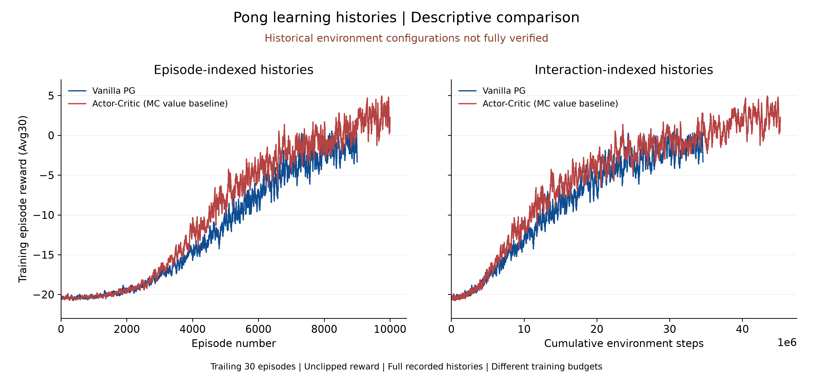
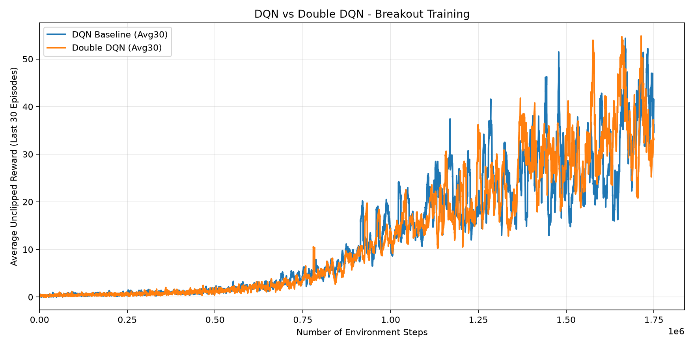
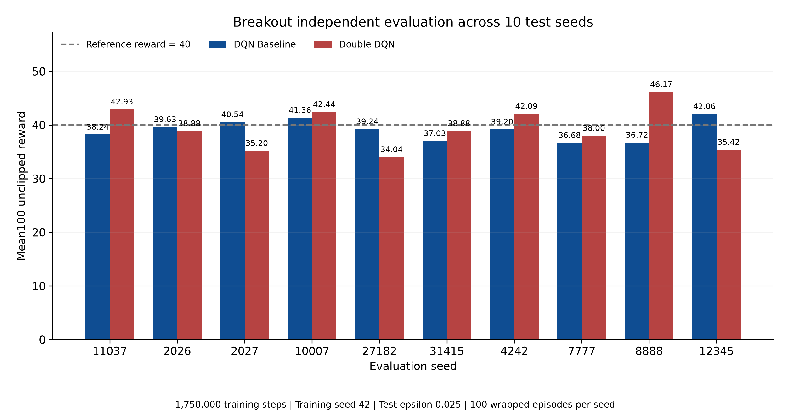

# PyTorch 与强化学习学习档案

个人学习项目：从 PyTorch 基础、MLP/CNN 到 Gymnasium 与 Atari 强化学习。已实现李宏毅 MLDS 2018 HW4-1 Pong 的 Vanilla Policy Gradient 与带 Monte Carlo 价值基线的 Actor-Critic，以及 HW4-2 Breakout 的 DQN 与 Double DQN，并保存真实训练记录、独立评估和曲线。

## 目录结构

```text
01_pytorch_basics/           张量、自动求导、优化和线性层
02_deep_learning/            MLP、分类、MNIST 与 CNN
03_reinforcement_learning/  Gymnasium、CartPole 和 REINFORCE 练习
projects/LiHongyi_RL2018/
  original-2018/             2018 官方作业源码模板（不改算法）
  modern_pg/                 Pong Vanilla PG
  modern_pg_improved/        Pong Actor-Critic（MC value baseline）
  modern_dqn/                Breakout DQN
  modern_double_dqn/         Breakout Double DQN
  results/                   训练 CSV、评估 CSV 和实验分析
  figures/                   汇总曲线与评估图
  archive/legacy_figures/    历史图与重复版本归档
  demo/                     演示录制脚本
RL/                         两份官方 HW4 作业说明 PPTX
 docs/                      学习与历史迁移记录
```

[项目入口](projects/README.md) · [实验数据说明](projects/LiHongyi_RL2018/results/experiment_data_notes.md) · [图片索引](projects/LiHongyi_RL2018/results/figure_inventory.md) · [历史迁移记录](docs/migration/README.md)

## 已实现的作业

| 作业 | 实现 | 内容 |
| --- | --- | --- |
| HW4-1 Pong | Vanilla PG | 帧差输入、动作 2/3、折扣回报、Return 标准化、策略梯度更新 |
| HW4-1 Pong | Actor-Critic | 独立 Critic 拟合 MC Return、价值基线、Advantage 标准化；并非 TD/A2C 实现 |
| HW4-2 Breakout | DQN | CNN、epsilon-greedy、Replay Buffer、TD 更新、Target Network、存档与续训 |
| HW4-2 Breakout | Double DQN | Online Network 选择下一动作，Target Network 估值 |

“已实现”指已有代码和历史实验记录；不表示每个入口均可在全新克隆后直接训练，也不表示通过原版评分验收。原始模板保持其待填写状态，完成的实现位于现代目录。

## 环境与运行

主要技术栈为 Python、PyTorch、Gymnasium、ALE、NumPy、OpenCV 和 Matplotlib；基础深度学习练习还使用 torchvision。历史环境报告记录 Python 3.11.17、PyTorch 2.11.0 CPU、Gymnasium 1.4.0、ALE 0.12.1、NumPy 2.4.6、OpenCV 5.0.0.93。依赖快照见 [requirements-lock.txt](projects/LiHongyi_RL2018/modern_dqn/requirements-lock.txt)，这些是历史记录，本次没有重新安装或执行长训练。

在仓库根目录创建独立环境并安装依赖：

```powershell
conda create -n mlds2018-hw4 python=3.11
conda activate mlds2018-hw4
python -m pip install -r projects/LiHongyi_RL2018/modern_dqn/requirements-lock.txt
python -m pip install matplotlib
python -m pip check
python -B projects/LiHongyi_RL2018/modern_dqn/smoke_test.py
```

ROM 由本机 ALE 安装环境提供，不随仓库提交。基础练习例如：

```powershell
python 01_pytorch_basics/01_tensors_and_devices/experiments/tensor_test.py
python 03_reinforcement_learning/02_policy_gradient/experiments/pg_cartpole.py
```

Pong Vanilla PG 入口为 `modern_pg/pg_agent_test.py`（名称虽有 test，实际会训练）。从仓库根目录运行：

```powershell
python -B projects/LiHongyi_RL2018/modern_pg/pg_agent_test.py
```

Actor-Critic 的入口仍引用不存在的 `modern/`，且共享的 `pg_policy`、`pg_preprocess` 位于 `modern_pg/`。不改训练代码时，可在独立 PowerShell 会话中设置模块路径后启动：

```powershell
$env:PYTHONPATH = (Resolve-Path projects/LiHongyi_RL2018/modern_pg).Path
python -B projects/LiHongyi_RL2018/modern_pg_improved/pg_agent_test.py
```

此启动方式未在本次重新训练验证，也不能证明历史两组训练使用了完全相同的环境。Breakout 两个目录的 `run_train.py` 均设 `RESUME=True`，权重未上传，直接运行会因找不到存档停止。新实验需先在相应入口选择新的 `RUN_NAME`、设置 `RESUME=False` 与训练步数，再运行：

```powershell
python -B projects/LiHongyi_RL2018/modern_dqn/run_train.py
python -B projects/LiHongyi_RL2018/modern_double_dqn/run_train.py
```

训练会写入日志与本地权重；不要复用归档实验名覆盖已有 CSV。评估脚本同样需要本地模型。`plot_pong_training_results.py` 从本地 Checkpoint 提取数据，无法仅凭本仓库重跑；现有 CSV 和 PNG 可直接阅读。基础 MNIST 的工作目录、CUDA 与模型路径限制见各主题 README。

## 实验记录与真实结果

Pong 数据来自已归档的逐局 CSV（由本地 Checkpoint 提取）：

| 算法 | 完成 Episodes | 累计环境 Steps | 最后 Avg30 |
| --- | ---: | ---: | ---: |
| Vanilla PG | 9,000 | 34,578,828 | -3.3333 |
| Actor-Critic（MC baseline） | 10,000 | 45,211,537 | 2.2667 |

Avg30 是最近 30 局训练奖励均值，不能代替独立评估。历史环境配置没有完全核实，两组结果只作描述性比较。详情见 [Pong 分析](projects/LiHongyi_RL2018/results/HW4-1_Pong_同训练步数数据分析.md)。



Breakout 保留 DQN 约 2,000,000 步、Double DQN 约 1,750,000 步的训练日志，以及固定 1,750,000 步模型的 10 个测试种子评估。每种算法每个测试种子 100 个包装 Episode，总计 2,000 条逐局记录：

| 固定训练 Seed 42 | 跨测试 seed 的 Mean100 平均 | Mean100 总体标准差 |
| --- | ---: | ---: |
| DQN | 39.0700 | 1.8108 |
| Double DQN | 39.4050 | 3.7347 |

测试 epsilon=0.025，奖励未裁剪；EpisodicLife 在掉命时结束 Episode，因此这里的 100 Episodes 不等于 100 场完整多命游戏。这是各一个训练模型的测试种子敏感性分析，不是多训练种子实验，也不能说明 Double DQN 普遍优于 DQN。旧评估表的部分均值与本轮不同，保留来源区分，未混合统计。详见 [协议、逐 seed 结果与差异说明](projects/LiHongyi_RL2018/results/dqn_eval_multiseed_1750000_notes.md)。




## 原始作业与现代实现

官方源码来自 [mldsta/mlds-2018-hw4](https://github.com/mldsta/mlds-2018-hw4)，固定提交 `c41312185c4923876e55cc60fa3d8ff702cb04e6`。`original-2018/` 保留源码与依赖说明；缓存和嵌套 Git 元数据不提交。`original-sha256.json` 为历史上游文件清单，其中缓存条目不随当前源码分发。

| 2018 作业 | 现代目录 |
| --- | --- |
| 旧 Gym、Pong-v0 / BreakoutNoFrameskip-v4 | Gymnasium、ALE/Pong-v5 / ALE/Breakout-v5，显式配置跳帧和 sticky action |
| reset 返回 obs，step 返回四项 done | 原生接口支持 reset 两项、step 五项；兼容桥接保留旧 Agent 调用方式 |
| scipy.misc.imresize、旧式包装器方法 | OpenCV 预处理、现代包装器方法 |
| Agent 留空模板 | PyTorch 网络、优化、训练、评估与实验记录 |

环境版本、随机数与终止处理差异意味着现代结果不能直接当作 2018 官方基线。`README_环境说明.md` 与 `modern_dqn/README.md` 是早期阶段记录，其“尚未实现”描述仅对应当时，当前实现状态以本页及源码为准。

## 提交范围与后续计划

保留源码、官方作业说明、轻量 CSV、实验分析与训练曲线。忽略 Conda/虚拟环境、Python 缓存、ROM、数据集、模型和 Replay 存档、视频、构建缓存、演示文稿草稿与安装日志；本地文件不删除。历史已跟踪的两个小型 MNIST 模型保留原状。实验记录中的本机路径改为相对路径，数值和模型哈希保持不变。

后续计划：整理统一配置与 CLI；明确训练/评估 Episode 口径；补全环境版本与续训状态记录；修复并验证 Actor-Critic 的独立运行入口；开展多训练种子重复实验；继续学习 PPO 等方法（尚未实现）。
