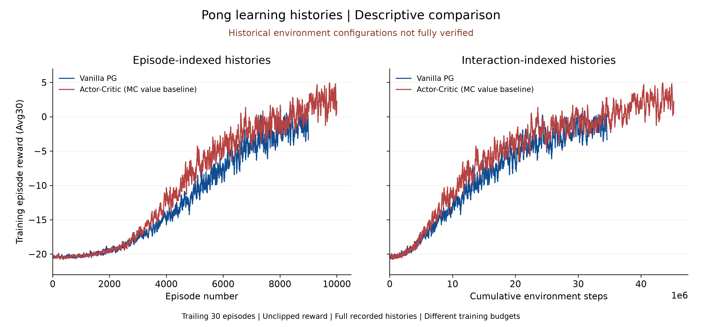

# HW4-1 Pong 同训练步数数据分析

## 范围与统计口径

使用两份已验收的 Checkpoint 导出 CSV，以共同累计环境交互预算 0–34,578,828 Steps 为范围。Vanilla PG 共纳入 9,000 个已完成 Episode，Actor-Critic 共纳入 8,461 个，后者末条记录为 34,575,040 Steps。AC 后续训练至 45,211,537 Steps 的结果不参与本次比较。

- 节点取累计步数不超过预算 B 的最后一个已完成 Episode，即 `max(episode where cumulative_environment_steps <= B)`，读取该行 Avg30。允许等于节点，未插值。实际观测步数和预算之间的差记录在 CSV 的 `*_step_gap`。
- 主要区间依次采用 (0,5M]、(5M,10M]、…、(30M,34,578,828]。按 Episode 结束时的累计 Steps 分组，每局等权，统计完整单局 Reward 的均值和总体标准差（ddof=0）。跨界 Episode 整体归入结束所在区间，其奖励不按步数拆分。最后一个区间约 457.88 万步，其余各 500 万步。
- 区间均值是这些已完成 Episode 的平均回报，标准差使用 `sqrt(sum((reward-mean)^2)/N)`。它们不表示每个环境交互步的奖励均值，也未按 Episode 长度加权。共同终点尚未完成的 Episode 不计入，缺少逐步 Reward 无法拆分其部分奖励。
- Avg30 为当前局及之前共 30 局奖励的算术均值。两个算法的 30 局对应的步数跨度可以不同，节点前最后记录也未必在同一步结束。
- 为检查分段敏感性，另作完整的每 100 万步分区，最后一段为 (34M,34,578,828]。全部 35 个细分区间均保存在汇总 CSV，避免只挑选某一局部区间。

## 指定节点的 Avg30 对照

差值统一定义为 Actor-Critic 减 Vanilla PG。下表四舍五入至四位小数，CSV 保留浮点计算值。

| 预算 Steps | PG Episode | PG 实际 Steps | PG Avg30 | AC Episode | AC 实际 Steps | AC Avg30 | AC−PG |
| ---: | ---: | ---: | ---: | ---: | ---: | ---: | ---: |
| 5,000,000 | 2,925 | 4,999,443 | -18.2000 | 2,891 | 4,997,541 | -17.7000 | +0.5000 |
| 10,000,000 | 4,490 | 9,997,188 | -12.7333 | 4,327 | 9,999,899 | -11.1667 | +1.5667 |
| 15,000,000 | 5,614 | 14,995,891 | -9.2333 | 5,331 | 14,996,691 | -5.4333 | +3.8000 |
| 20,000,000 | 6,561 | 19,999,066 | -6.4667 | 6,206 | 19,994,316 | -4.9333 | +1.5333 |
| 25,000,000 | 7,429 | 24,995,223 | -5.1667 | 7,018 | 24,999,168 | -3.9667 | +1.2000 |
| 30,000,000 | 8,257 | 29,994,487 | -2.3667 | 7,792 | 29,999,324 | -0.0333 | +2.3333 |
| 34,578,828 | 9,000 | 34,578,828 | -3.3333 | 8,461 | 34,575,040 | 1.7667 | +5.1000 |

七个节点均为 AC 的 Avg30 较高，差值在 +0.5000 至 +5.1000 之间。共同终点使用 AC 第 8,461 局的 1.7667，对应 PG 第 9,000 局的 −3.3333。这里没有使用 AC 第 10,000 局的末期成绩。

## 相同步数区间的单局奖励统计

每个区间列出 Episode 数量 N、平均 Reward 和总体标准差 SD。

| Steps 区间（左开右闭） | PG N | PG 均值 | PG SD | AC N | AC 均值 | AC SD | 均值 AC−PG |
| --- | ---: | ---: | ---: | ---: | ---: | ---: | ---: |
| (0, 5,000,000] | 2,925 | -19.7231 | 1.4303 | 2,891 | -19.7036 | 1.4742 | +0.0195 |
| (5,000,000, 10,000,000] | 1,565 | -15.5706 | 3.0739 | 1,436 | -14.3454 | 3.8781 | +1.2252 |
| (10,000,000, 15,000,000] | 1,124 | -10.7963 | 4.5851 | 1,004 | -8.4253 | 5.6000 | +2.3710 |
| (15,000,000, 20,000,000] | 947 | -6.9947 | 5.7263 | 875 | -5.1166 | 6.1196 | +1.8781 |
| (20,000,000, 25,000,000] | 868 | -3.9597 | 6.3935 | 812 | -2.6810 | 6.5115 | +1.2786 |
| (25,000,000, 30,000,000] | 828 | -2.5749 | 6.4229 | 774 | -1.2067 | 6.5615 | +1.3682 |
| (30,000,000, 34,578,828] | 743 | -1.5087 | 6.6009 | 669 | -0.5456 | 6.4316 | +0.9632 |

## 主要观察

1. **总体分段表现。** 七个主要区间的单局平均 Reward 均为 AC 较高。0–500 万步差值仅 +0.0195，两个算法均接近 −20。500–1,500 万步均值改善，差距扩大至 +1.2252 和 +2.3710。其后四段 AC 仍较高，差距在 +0.9632 至 +1.8781 之间。
2. **局部反转。** 每 100 万步分区中，PG 仅在 (1M,2M] 的单局均值略高。其相邻区间的方向如下。这是早期很小的局部反转，不构成持续领先的证据。主要 500 万步区间和七个节点未观察到优势反转，也不能据此排除更短尺度的曲线交叉。

| Steps 区间 | PG 平均 Reward | AC 平均 Reward | AC−PG |
| --- | ---: | ---: | ---: |
| (0, 1,000,000] | -20.4044 | -20.3972 | +0.0072 |
| (1,000,000, 2,000,000] | -20.2086 | -20.2398 | -0.0312 |
| (2,000,000, 3,000,000] | -19.7752 | -19.7631 | +0.0121 |

3. **样本效率的证据范围。** 相同步数节点及主要分段整体支持本次 AC 训练记录呈现较好的 Reward–交互预算关系，可作为样本效率较高的描述性迹象。历史环境和预处理配置尚未完全核实，且每种算法只有一次训练轨迹，因此无法将差距确认为 Critic 的因果收益或可推广的算法优势。
4. **Reward 波动。** 两种算法在后期区间的单局 Reward 标准差均比早期大。AC 在前六个主要区间的 SD 高于 PG，最后一个区间低于 PG，因此“AC 全程更稳定”不符合这些统计。SD 汇总的是不断更新的策略下单局结果的离散程度，还混合区间内学习趋势、Episode 长度和轨迹随机性。它没有测量梯度估计，不能直接解释为梯度方差、跨训练种子方差或独立评估的不确定性。

## 既有图与证据局限

此图右侧展示累计环境 Steps，本分析仅采用 34,578,828 Steps 以内的记录。图中 AC 超出共同范围的尾段不参与比较，左侧按 Episode 编号对齐也不代表相同交互预算。图内的环境配置未完全核实提示继续适用。

- **实验观察** 为上述节点、均值和标准差，均来自训练期间的完整 Episode Reward，没有独立测试 Mean100。
- **合理假设** 是价值基线可能改变策略更新信号的质量，并影响学习过程。现有数据未测量 Advantage、价值误差或梯度方差，无法验证该机制。
- **无法证明的结论** 包括 Critic 已被证明更优、AC 具有统计显著或普遍的样本效率优势，以及奖励波动直接反映梯度方差。历史运行环境、封装、预处理版本及完整续训配置仍待核实。
- Episode 数据沿训练过程相关，Avg30 的相邻窗口高度重叠，区间标准差不能直接当作独立样本推断用的置信区间。本次没有显著性检验。

## 后续值得讨论的问题

- 能否从历史运行材料恢复两组环境、预处理及续训配置的一致性？
- 早期 (1M,2M] 的微小差异在重复训练中是否保留，分区尺度改变时是否仍存在？
- 若讨论价值基线机制，需要哪些 Advantage、Critic 误差或梯度统计记录来区分解释？
- 相同交互预算下的训练 Reward 优势是否会反映在固定策略的独立测试中？现有资料不能回答。

## 来源、CSV 结构与检查

来源为 [Vanilla PG 训练 CSV](pong_vanilla_pg_training_records.csv)、[Actor-Critic 训练 CSV](pong_actor_critic_training_records.csv)、[数据说明](experiment_data_notes.md) 和 [图片索引](figure_inventory.md)。两份训练 CSV 已在上一阶段与对应 Checkpoint 逐条验收，本次重新检查 CSV 结构、连续编号、有限数值、步数递增、记录总量和全部有效 Avg30。

[同训练步数汇总 CSV](pong_pg_ac_equal_steps_summary.csv) 共 49 行统计记录，`checkpoint_asof` 为 7 个节点，`interval_5m` 为 7 个主要区间，`interval_1m` 为 35 个细分区间。三类记录是重叠的分析视角，不能合并累加。节点记录的区间起点及区间统计字段留空，区间记录的单个 Episode／Avg30 字段留空，表示不适用。`pg_` 为 Vanilla PG，`ac_` 为 Actor-Critic，所有差值为 AC−PG。源 CSV 文件名在每行保留，相对于本 results 目录。

统计使用 Python 标准库 `csv`、`bisect_right`、`statistics.mean`、`statistics.pstdev`。节点选择另以过滤后取最大 Episode 复核，均值与 SD 使用直接求和公式独立复算。两种分区的 N 分别汇总为 PG 9,000、AC 8,461，未漏算或重复归入同一套分区。

输入 SHA-256 如下。

- Vanilla PG `3bfa688ddd7efafeaebe6b2eaa3c8029e6faac70df72c012ef550715795bae42`
- Actor-Critic `fdcd037c0d3eeccdf15e9600ad39fd54c5d3a24fd5e466ef97e547fcfd9388e9`

本次输入检查与统计复核通过，未发现异常记录。
