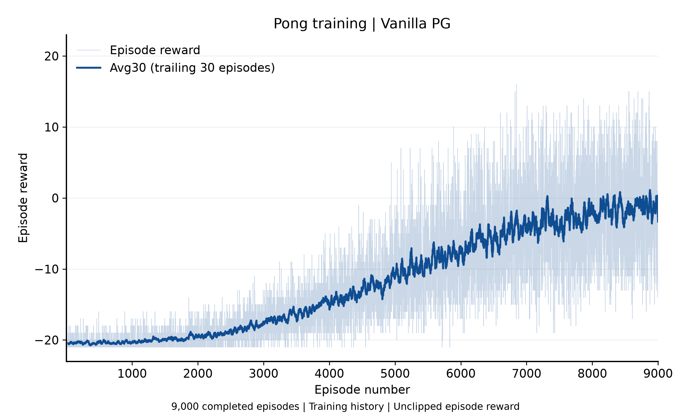
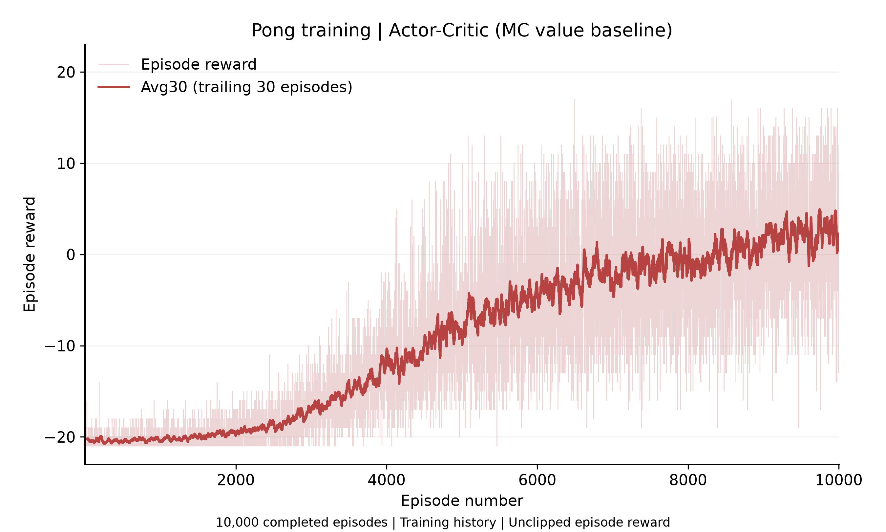

# HW4-1 Pong 实验结果汇总

## 数据范围与指标

本汇总分别描述 Vanilla PG 和 Actor-Critic 的历史训练结果。逐局统计来自已导出的 CSV，算法说明依据当前代码。历史环境配置不完整，两组结果分别解释。

| 实验 | 完成 Episodes | 累计环境 Steps | 前 30 局 Avg30 | 最后 30 局 Avg30 |
| --- | ---: | ---: | ---: | ---: |
| Vanilla PG | 9,000 | 34,578,828 | −20.4667 | −3.3333 |
| Actor-Critic | 10,000 | 45,211,537 | −20.2000 | 2.2667 |

Episode Reward 为单局环境奖励总和。第 \(n\) 局的滑动平均定义为

\[
\operatorname{Avg30}(n)=\frac{1}{30}\sum_{i=n-29}^{n}R_i,\qquad n\geq30.
\]

前 29 局的 Avg30 留空。Steps 为每次外层 `env.step()` 调用累加的累计环境交互数，与模拟器帧数不同。两份 CSV 的行数、最终累计步数及全部有效 Avg30 已重新核对。

数据来自 Vanilla 和改进版各自的 `checkpoints/pong_pg_latest.pt`，上一阶段以 `weights_only=True` 提取为 CSV。本阶段从 CSV 计算指标，另以只读方式检查两份 Checkpoint 中 Actor 参数的形状。[Vanilla 训练记录](pong_vanilla_pg_training_records.csv)、[Actor-Critic 训练记录](pong_actor_critic_training_records.csv)、[数据归档说明](experiment_data_notes.md)

## 算法原理与网络

### Vanilla Policy Gradient

Actor 从分类分布采样动作，输出映射到 Pong 动作 2 和 3。输入为灰度、80×80、除以 255 归一化后的相邻观察帧差，首帧差为零。网络为 `Flatten(6400) → Linear(6400,256) → ReLU → Linear(256,2)`，输出两个动作的 logits。

每局收集完整轨迹，按逆序递推 \(G_t=r_t+\gamma G_{t+1}\)。遇到非零奖励时先将后续累计回报清零，因此折扣回报按得失分片段计算。将局内 Return 标准化后更新策略

\[
L_\pi=-\sum_t\log\pi_\theta(a_t\mid s_t)\widehat G_t.
\]

标准化使用局内总体标准差（`unbiased=False`），分母加 \(10^{-8}\)。[Agent 实现](../modern_pg/pg_agent.py)、[Actor 网络](../modern_pg/pg_policy.py)、[图像预处理](../modern_pg/pg_preprocess.py)

### Actor-Critic（MC 价值基线）

改进版用独立 Critic 估计 \(V_\phi(s_t)\)，使用相同的分段 Monte Carlo Return，分别计算

\[
L_V=\frac1T\sum_t(V_\phi(s_t)-G_t)^2,\qquad
A_t=G_t-\operatorname{stopgrad}(V_\phi(s_t)),
\]
\[
L_\pi=-\sum_t\log\pi_\theta(a_t\mid s_t)\widehat A_t.
\]

Advantage 在局内标准化。每局先更新 Critic，再更新 Actor，Actor 所用 Advantage 由更新前的价值预测计算。当前实现属于 MC 价值基线形式，未使用一步 TD Advantage 或 GAE。

Checkpoint 中两组 Actor 的权重形状均为 `(256,6400)` 和 `(2,256)`，对应 6400→256→2。改进版 Critic 为 `Flatten(6400) → Linear(6400,256) → ReLU → Linear(256,1)`。改进版 Actor 与预处理通过外部模块导入，历史源文件版本待核实。[改进版 Agent](../modern_pg_improved/pg_agent.py)、[Critic 网络](../modern_pg_improved/pg_critic.py)

## 主要训练配置

以下为当前代码可核实的设置，历史运行版本与完整续训配置待核实。

| 项目 | Vanilla PG | Actor-Critic |
| --- | --- | --- |
| 折扣因子 γ | 0.99 | 0.99 |
| Actor 优化器与学习率 | Adam，1×10⁻⁴ | Adam，1×10⁻⁴ |
| Critic 优化器与学习率 | 无 Critic | Adam，1×10⁻⁴ |
| 更新频率 | 每完成一局更新一次 Actor | 每完成一局各更新一次 Critic、Actor |
| 策略训练信号 | 标准化 Return | 标准化 Advantage |
| 标准化分母常数 | 10⁻⁸ | 10⁻⁸ |
| 入口随机种子 | Python、NumPy、Torch、环境均设为 42 | 同左 |
| 入口环境参数 | `Pong-v0`，`atari_wrapper=False`，`test=True` | 同左 |

`test=True` 在这里控制环境处理方式，入口随后调用 `train()`，这些记录属于训练轨迹。当前 Vanilla 环境映射至 `ALE/Pong-v5`，frame skip 为 `(2,5)`，sticky action 概率为 0，最大 27,000 步，PG 路径使用未裁剪奖励。[Vanilla 训练入口](../modern_pg/pg_agent_test.py)、[改进版训练入口](../modern_pg_improved/pg_agent_test.py)、[当前 Vanilla 环境](../modern_pg/environment.py)

## 训练表现

下表为指定 Episode 结束时的最近 30 局均值，由各自 CSV 的原始 Episode Reward 重新计算，保留四位小数。

| Episode | Vanilla PG Avg30 | Actor-Critic Avg30 |
| ---: | ---: | ---: |
| 30 | −20.4667 | −20.2000 |
| 1,000 | −20.2667 | −20.4667 |
| 3,000 | −17.6667 | −16.9667 |
| 6,000 | −7.1667 | −4.0000 |
| 9,000 | −3.3333 | 1.5000 |
| 10,000 | 无记录 | 2.2667 |

Vanilla PG 前期接近 −20，随后整体改善，后期仍有波动。Avg30 首次大于 0 出现在第 7,315 局，最高为第 8,877 局的 1.1333，最后回到 −3.3333。全程单局 Reward 范围为 [−21,16]，记录中没有 Avg30 大于 3 的窗口。

Actor-Critic 的独立记录同样表现为前期较低、后期改善。Avg30 首次大于 0 出现在第 6,618 局，首次大于 3 出现在第 9,037 局，最高为第 9,746 局的 4.9333，末期为 2.2667。单局 Reward 范围为 [−21,17]。首次越过阈值描述一个滑动窗口，不代表持续保持该水平。上述结果为训练统计，独立评估结果待核实。[Vanilla 数据](pong_vanilla_pg_training_records.csv)、[Actor-Critic 数据](pong_actor_critic_training_records.csv)

## 图表

两图横轴均为 Episode Number，浅色线为原始 Episode Reward，实色线为 Avg30。各图展示自身完整训练区间。

## 已知限制与待核实事项

- 历史环境版本、封装参数及导入来源待核实。改进版入口引用 `../modern`，该目录目前不存在，改进版目录自身也缺少 `environment.py`、`pg_policy.py` 和 `pg_preprocess.py`。因此当前 Vanilla 环境配置不能直接视为改进版历史环境配置。
- 两份 Checkpoint 未完整保存运行配置及随机数状态，续训次数、每次运行种子状态与历史代码版本待核实。当前代码设置 Seed 42 不能证明全部历史轨迹来自完全一致的随机过程。
- 完成局数和累计交互预算不同，环境可比性尚未确认，暂不据此对两种算法作严格优劣排序。
- 曲线来自各自一次历史训练，滑动窗口彼此重叠。跨训练种子的方差、置信区间、策略独立评估和完整游戏终止／截断比例均待核实。
