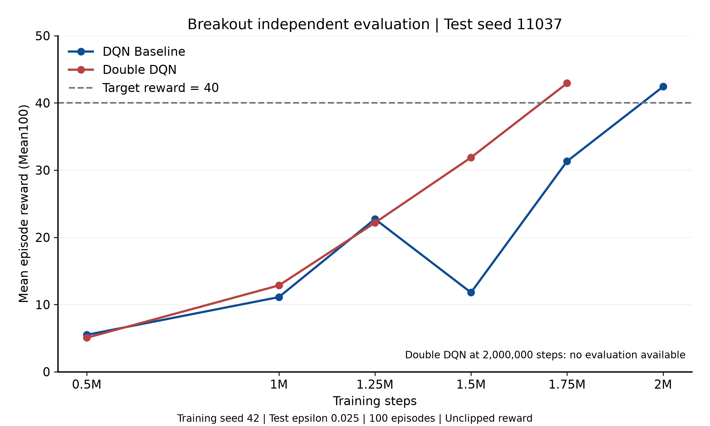
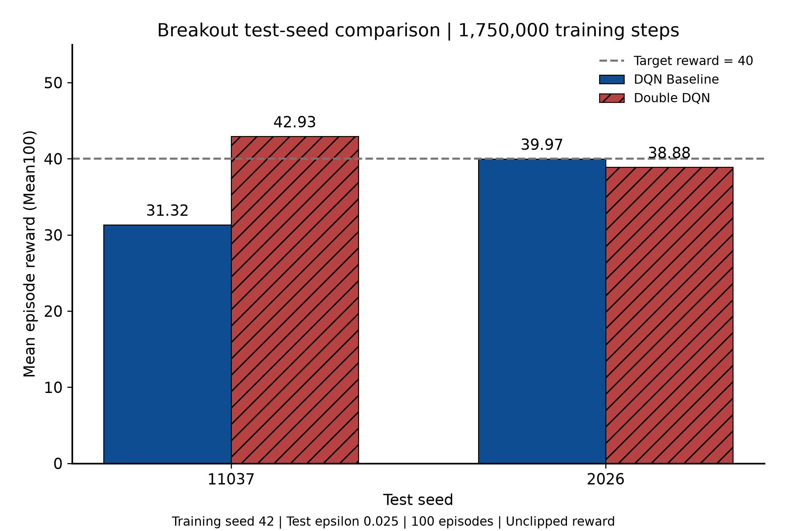

# HW4-2 Breakout 实验结果汇总

## 数据来源与实验范围

独立评估表使用用户确认并归档的 13 条历史均值记录。统一训练 Seed 42、测试 ε=0.025、每组 100 Episodes、未裁剪 Reward。训练配置依据当前代码，历史代码与运行配置的一一对应关系待核实。[评估 CSV](dqn_evaluation_records.csv)、[数据归档说明](experiment_data_notes.md)

## 算法差异

两者均使用 Online Q-Network、Target Q-Network、经验回放和 ε-greedy 探索。当前 `_compute_td_targets()` 的差异体现为下一状态动作的选择和估值方式。记 \(d_t\) 为传入的 `terminated` 标志，DQN 使用

\[
y_t^{\mathrm{DQN}}=r_t+\gamma(1-d_t)\max_a Q_{\theta^-}(s_{t+1},a).
\]

Double DQN 由 Online 网络选择动作，再用 Target 网络评价

\[
a^*=\arg\max_a Q_\theta(s_{t+1},a),\qquad
y_t^{\mathrm{DDQN}}=r_t+\gamma(1-d_t)Q_{\theta^-}(s_{t+1},a^*).
\]

这一设计旨在减轻最大化估计的过高偏差。本次记录没有直接测量 Q 值估计偏差，因此该机制对本次成绩的具体贡献待核实。两者都以 MSE 拟合 TD Target，Target 计算置于 `torch.no_grad()` 中。`truncated` 会触发回合重置，但 TD bootstrap mask 仅使用 `terminated`。[DQN Agent](../modern_dqn/agent_dqn.py)、[Double DQN Agent](../modern_double_dqn/agent_dqn.py)

## CNN 与主要超参数

当前两目录的 `q_network.py`、`replay_buffer.py`、`environment.py` 和 `atari_wrapper.py` 内容相同。输入为 84×84 灰度图、归一化至 [0,1]、堆叠四帧，进入网络时转为 BCHW。

| 层 | 参数 | 输出形状，省略 Batch |
| --- | --- | --- |
| 输入 | 四帧 | 4×84×84 |
| Conv1 + ReLU | 4→32，kernel 8，stride 4 | 32×20×20 |
| Conv2 + ReLU | 32→64，kernel 4，stride 2 | 64×9×9 |
| Conv3 + ReLU | 64→64，kernel 3，stride 1 | 64×7×7 |
| Flatten + Linear + ReLU | 3136→512 | 512 |
| Q 输出 | 512→4 | NOOP、FIRE、RIGHT、LEFT 的 Q 值 |

网络末层输出未归一化的动作价值。[CNN 实现](../modern_dqn/q_network.py)、[环境动作映射](../modern_dqn/environment.py)

| 配置 | 两种算法的当前设置 |
| --- | --- |
| 优化器 | Adam，学习率 1.5×10⁻⁴ |
| 折扣因子 γ | 0.99 |
| Replay 容量 | 10,000 条 Transition |
| Batch Size | 32 |
| Online 更新 | 每 4 个外层环境 Steps，且 Replay 至少含 32 条记录 |
| Target 同步 | 每 1,000 个外层环境 Steps，硬复制参数 |
| 探索率 | 从 1.0 线性降至 0.025，衰减区间为前 1,000,000 Steps |
| Checkpoint 保存间隔 | 10,000 Steps |
| 训练入口种子 | Python、NumPy、Torch、环境均设为 42 |
| 当前入口追加预算 | 每次 250,000 Steps，`RESUME=True` |

Steps 为 Agent 外层交互计数。底层 `ALE/Breakout-v5` 设置 frameskip=1、sticky action 概率 0，封装以 skip=4 重复动作、池化末两帧，重置时随机执行 1–30 次 NOOP 并执行 FIRE。重置内部动作和提前终止使外层 Steps 与原始帧数不能简单等同。[Baseline 训练入口](../modern_dqn/run_train.py)、[Double DQN 训练入口](../modern_double_dqn/run_train.py)、[Atari 封装](../modern_dqn/atari_wrapper.py)

## 训练与独立评估的区别

训练时，Replay 中的奖励经过符号裁剪，Agent 持续更新网络并按计划降低 ε。CSV 训练日志累计 `info["raw_reward"]`，因此日志 Episode Reward 和 Avg30 使用未裁剪奖励。独立评估加载固定 Checkpoint，设置 ε=0.025，重新设置测试种子，使用 `test=True` 环境累加未裁剪奖励，期间只选择动作。

当前封装在训练和测试时都启用 `EpisodicLifeEnv`，丢命会形成包装后的 Episode 边界。因此 Mean100 表示该测试流程下 100 个包装 Episode 的平均奖励，完整多条命游戏的平均分口径待另行核实。训练日志 Avg30 是持续更新策略下最近 30 个训练 Episode 的滑动平均，与固定 Checkpoint 的 Mean100 分别解释。[Baseline 评估脚本](../modern_dqn/evaluate_dqn.py)、[跨算法评估脚本](../modern_double_dqn/evaluate_dqn.py)、[包装流程](../modern_dqn/atari_wrapper.py)

训练日志最后一条完整 Episode 分别结束于 Baseline 第 1,999,847 步（第 18,141 局）和 Double DQN 第 1,749,992 步（第 17,705 局）。日志只在 Episode 结束时写入，因此末条日志步数与训练节点存在间距。[Baseline 日志](../modern_dqn/logs/dqn_baseline_cpu_01.csv)、[Double DQN 日志](../modern_double_dqn/logs/double_dqn_cpu_01.csv)

## 独立评估结果

测试 Seed 11037，指标为 Mean100，差值为 Double DQN 减 DQN。

| Training Steps | DQN Baseline | Double DQN | 差值 |
| ---: | ---: | ---: | ---: |
| 500,000 | 5.50 | 5.06 | −0.44 |
| 1,000,000 | 11.11 | 12.85 | +1.74 |
| 1,250,000 | 22.72 | 22.17 | −0.55 |
| 1,500,000 | 11.79 | 31.88 | +20.09 |
| 1,750,000 | 31.32 | 42.93 | +11.61 |
| 2,000,000 | 42.42 | 无数据 | 无数据 |

1,750,000 Steps 下两个测试种子的结果如下。

| 测试 Seed | DQN Baseline Mean100 | Double DQN Mean100 | 差值 |
| ---: | ---: | ---: | ---: |
| 11037 | 31.32 | 42.93 | +11.61 |
| 2026 | 39.97 | 38.88 | −1.09 |

两个表均直接取自归档 CSV，差值按所列两位小数计算。[独立评估记录](dqn_evaluation_records.csv)

## 观察与解释边界

**已观察事实。** 测试 Seed 11037 下，Baseline 从 125 万步的 22.72 回落至 150 万步的 11.79，下降 10.93，随后在 175 万和 200 万步回升至 31.32、42.42。Double DQN 在已记录节点中首次超过 Reward 40 的节点为 175 万步（42.93），Baseline 为 200 万步（42.42），相差一个 25 万步的记录间隔。这描述本次训练和测试 Seed 下的已测节点，精确首次跨越时刻待核实。

**测试种子结果。** 175 万步时，Seed 11037 下 Double DQN 较高，Seed 2026 下 Baseline 较高。优势随测试种子变化，两个种子不足以推断跨种子稳定性，Double DQN 在 Seed 2026 下也未超过 Reward 40。

**可能原因。** 策略随更新发生变化、回放样本构成变化和有限测试样本的波动，都可能参与形成 Baseline 的非单调成绩。现有均值记录无法区分这些原因。

**尚未验证的推测。** Deadly Triad 或灾难性遗忘是否参与该回落待核实，需要训练过程诊断或针对性实验。当前结果不能建立这些机制与回落之间的因果关系。Double DQN 的偏差降低机制是否导致本次较早达到阈值，同样待核实。

## 图表

第一图横轴按真实训练步数间距排列，纵轴为独立评估 Mean100，虚线为 Reward 40。Double DQN 曲线止于 175 万步。

第二图展示 175 万步下两组测试种子的均值。

## 待核实信息

- 当前评估脚本中的配置反映最近编辑状态，所有历史评估命令、代码版本与 Checkpoint 的完整对应关系待核实。Baseline 评估脚本部分结果打印文案仍使用旧步数标签，本文以归档 CSV 的 `training_steps` 为准。
- 归档 CSV 保存用户确认的均值，逐 Episode 独立评估记录及对应标准差未归档，置信区间与显著性待核实。
- 训练只有 Seed 42 的本次记录，跨训练种子的复现性、两算法整体稳定性待核实。测试种子变化与重新训练的种子变化属于不同实验维度。
- Double DQN 的 200 万步评估缺失，完整多条命游戏评分、历史软件版本与运行设备待核实。实验名包含 `cpu`，但当前 Agent 自动选择 CUDA 或 CPU，名称不足以确认设备。
